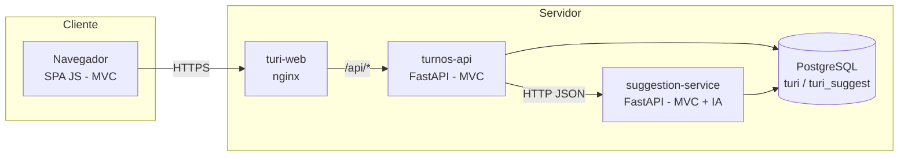
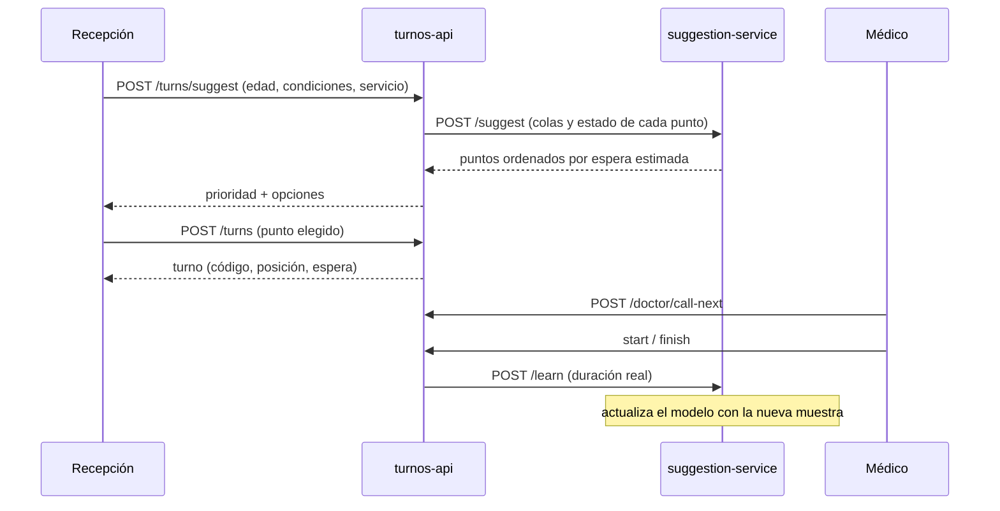
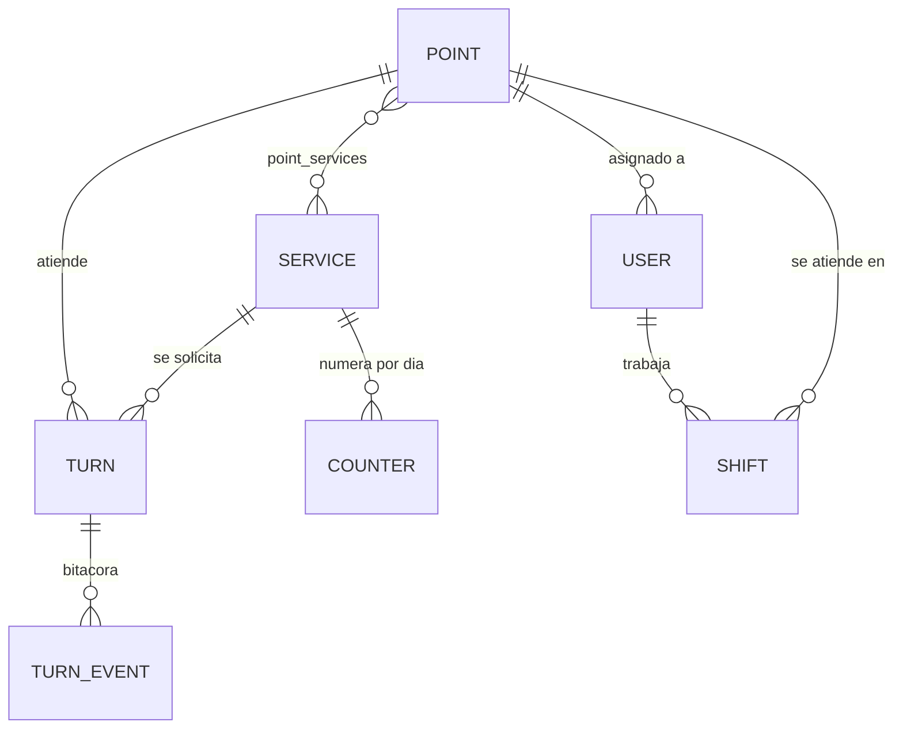
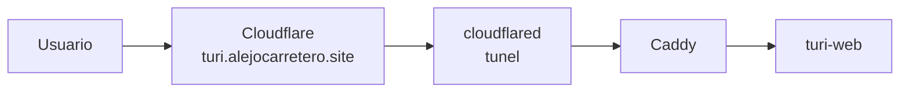

# Arquitectura de Turi

Sistema de gestión y priorización de turnos para entidades de salud. Este documento describe los componentes, sus responsabilidades y cómo se aplica el patrón MVC en cada uno.

## 1. Visión general

Turi se compone de **cuatro contenedores** que se ejecutan con Docker Compose:



| Componente | Tecnología | Responsabilidad principal |
|---|---|---|
| `turi-web` | nginx + JavaScript (módulos ES) | Sirve la aplicación web y reenvía `/api/*` a `turnos-api`. Aplica cabeceras de seguridad. |
| `turnos-api` | FastAPI + SQLAlchemy | Reglas de negocio de turnos: autenticación por rol, registro, prioridad, fila, llamado, atención, indicadores, pantalla pública. Es la **única** fuente de verdad del negocio. |
| `suggestion-service` | FastAPI + SQLAlchemy | Microservicio de IA: estima la duración de cada atención, sugiere el punto con menor espera y calcula el tiempo de espera de cada turno. Aprende de las atenciones finalizadas. |
| `db` | PostgreSQL 16 | Dos bases independientes: `turi` (negocio) y `turi_suggest` (estadísticas del modelo). |

Principios de diseño:

- **Separación de responsabilidades.** `turnos-api` decide *qué* pasa con un turno; `suggestion-service` solo responde *cuánto tardará*. Ninguno accede a la base del otro.
- **Degradación elegante.** Si `suggestion-service` no responde, `turnos-api` usa una estimación básica (suma de tiempos base por servicio) y sigue operando. El cliente muestra el aviso "estimación básica".
- **Mínima información pública.** La pantalla de espera y la consulta del paciente solo exponen códigos de turno y nombre abreviado, nunca documento ni teléfono.

## 2. Patrón MVC

El patrón se aplica con el mismo criterio en los tres componentes de código:

| Capa | Qué contiene | Qué NO debe hacer |
|---|---|---|
| **Modelo (M)** | Entidades persistidas, reglas de dominio y acceso a datos. | Conocer HTTP, JSON de respuesta o HTML. |
| **Vista (V)** | Cómo se presenta la información: esquemas/presentadores JSON en la API; plantillas HTML en el cliente. | Tomar decisiones de negocio ni acceder a la base. |
| **Controlador (C)** | Recibe la petición o el evento, invoca al modelo/servicios y entrega el resultado a la vista. | Contener reglas de negocio (se delegan en servicios). |

### 2.1 `turnos-api`

```
turnos-api/app/
├── main.py                  Ensamblaje: routers, manejador de errores, arranque
├── core/                    Infraestructura transversal
│   ├── config.py            Variables de entorno
│   ├── database.py          Motor y sesión SQLAlchemy
│   └── security.py          JWT, hash de contraseñas, control de acceso por rol
├── migrations/              Alembic: versiones del esquema (0001 base, 0002 prioridad/puntos, 0003 usuarios activos)
├── models/                  MODELO
│   └── entities.py          Turn, Point, Service, User, Counter, TurnEvent
├── services/                MODELO (lógica de dominio, sin HTTP)
│   ├── priority.py          Clasificación de prioridad y validación de edad
│   ├── queueing.py          Orden de la fila, numeración, bitácora
│   ├── turn_service.py      Casos de uso: crear, editar, cancelar, reasignar, llamar, atender
│   ├── report_service.py    Indicadores, pantalla pública, consulta del paciente
│   ├── model_service.py     Prueba del modelo: reporte de entrenamiento y respuestas
│   ├── events.py            Difusión en tiempo real (SSE): un commit en la base avisa a los clientes
│   ├── availability.py      Estado de cada punto según horarios del personal (puro, sin HTTP)
│   ├── resource_service.py  Alta/edición de puntos, personal y turnos de trabajo
│   ├── suggest_client.py    Cliente del microservicio de IA (con respaldo)
│   └── errors.py            DomainError (el controlador lo traduce a HTTP)
├── views/                   VISTA
│   ├── schemas.py           Contratos de entrada validados (Pydantic)
│   └── presenters.py        Entidad -> JSON de salida (oculta datos personales en lo público)
├── controllers/             CONTROLADOR (un router por área)
│   ├── auth.py  catalog.py  turns.py  doctor.py  public.py  supervisor.py  model.py  resources.py  events.py
└── seeds/                   Datos iniciales y de demostración
```

Regla de dependencias: `controllers → services → models`; `controllers → views`. Los servicios nunca importan controladores ni FastAPI. Los errores de negocio se lanzan como `DomainError` y un único manejador global los convierte en la respuesta HTTP.

### 2.2 `suggestion-service`

```
suggestion-service/app/
├── main.py                  Ensamblaje
├── core/database.py         Motor y sesión
├── models/
│   ├── entities.py          Stat (media), TrainingLog (predicción vs. realidad) y Attention (cada atención)
│   ├── estimator.py         Estimación EMA, aprendizaje y reporte de efectividad (ver MODELO_IA.md)
│   └── sk_model.py          scikit-learn (Ridge por franja horaria) que se mezcla con el EMA (modo híbrido)
├── views/schemas.py         Contratos JSON de entrada y salida
└── controllers/routes.py    /suggest  /estimate  /predict  /learn  /model/report  /model/stats  /health
```

### 2.3 Aplicación web (cliente)

JavaScript nativo con módulos ES (sin paso de compilación). Cada carpeta es una capa:

```
web/public/js/
├── main.js                  Router por hash y control de acceso por rol
├── core/                    Utilidades: DOM, íconos, formato, temporizadores, live.js (tiempo real por SSE)
├── models/                  MODELO
│   ├── api.js               Cliente HTTP (token, errores normalizados)
│   ├── repository.js        Una función por operación de la API
│   ├── session.js           Sesión del usuario
│   ├── rules.js             Reglas replicadas (rango de edad de gestante)
│   └── constants.js         Estados, roles, rutas de inicio
├── views/                   VISTA: funciones puras que devuelven HTML
│   ├── layout.js  components.js  login.view.js  reception.view.js
│   ├── doctor.view.js  supervisor.view.js  queue.view.js  model.view.js  resources.view.js
│   └── display.view.js  lookup.view.js
└── controllers/             CONTROLADOR: cargan datos, pintan la vista, enlazan eventos
    ├── auth  reception  doctor  supervisor  queue  model  resources  display  lookup
    └── shell.js             Estructura común (barra lateral)
```

Flujo típico: el *router* elige un controlador → el controlador pide datos al `repository` (modelo) → pasa los datos a una función de la *vista* que devuelve HTML → el controlador lo inserta y enlaza los eventos.

## 3. Roles y pantallas

| Rol | Pantallas | Acciones permitidas |
|---|---|---|
| Recepción | Recepción | Registrar paciente, aceptar/cambiar el punto sugerido, editar, reasignar, reincorporar, cancelar. |
| Atención (médico) | Mi consultorio | Llamar siguiente, llamar de nuevo, iniciar, marcar no presentado, finalizar, pausar el punto. |
| Supervisión | Indicadores, Fila general, Administración, Prueba del modelo | Ver indicadores, ver todos los turnos del día (activos, atendidos, cancelados) con tiempos de espera y atención, simular llegadas, revisar el entrenamiento y la efectividad de la IA y hacerle consultas, **crear servicios, abrir/cerrar consultorios y laboratorios, crear usuarios de cualquier rol (activar/desactivar, cambiar clave y rol) y asignar horarios al personal de atención**. |
| Público (sin sesión) | Pantalla de espera, Consulta | Ver turnos llamados y próximos por punto; consultar un turno por código o documento. |

El acceso se verifica en el servidor (`require(...)` en cada endpoint) y se refleja en el cliente solo para la navegación.

## 4. Flujo principal



## 5. Modelo de datos (`turi`)



- `TURN` guarda el paciente, la clase de prioridad (`PREFERENCIAL`, `NORMAL`, `BAJA`), el estado (`WAITING`, `CALLED`, `IN_SERVICE`, `DONE`, `CANCELLED`, `NO_SHOW`) y las marcas de tiempo (llegada, llamado, inicio, fin).
- `TURN_EVENT` registra cada cambio (quién, cuándo, qué) para auditoría.
- `COUNTER` garantiza numeración diaria sin duplicados (`CG-001`, `CG-002`…) mediante bloqueo de fila.

## 6. Reglas de negocio centrales

| Regla | Detalle | Dónde vive |
|---|---|---|
| Prioridad preferencial | Edad ≥ 60, gestante o discapacidad. | `services/priority.py` |
| Rango de edad de gestante | Solo se admite entre **10 y 55 años**. Fuera de ese rango se rechaza (HTTP 422) al sugerir, crear y editar. El cliente además bloquea la opción. | `services/priority.py`, `views/schemas.py`, `models/rules.js` |
| Orden de la fila | Clave = hora de ingreso − adelanto. Preferencial: adelanto mínimo 20 min; reincorporado (BAJA) cede 15 min. | `services/queueing.py` |
| Atención prioritaria guiada por el modelo | Al asignar punto, el modelo calcula la espera del paciente prioritario en cada punto y **sube el adelanto de 5 en 5 min (20 → 60)** hasta cumplir la meta de espera (≤ 10 min) o llegar al tope. El adelanto elegido se guarda en el turno (`bonus_min`) y determina su posición. Recepción ve, por punto, el adelanto, los minutos ahorrados y si se cumple la meta. Los normales no reciben adelanto; para los prioritarios pesa más la espera que la duración de su propia atención. | `suggestion-service/controllers/routes.py` (`/suggest`), `services/turn_service.py` |
| No presentado | Pasa a `NO_SHOW`; recepción lo reincorpora con prioridad baja. | `services/turn_service.py` |
| Puntos y horarios | El supervisor crea puntos (nombre + servicios) y funcionarios, y asigna **turnos de trabajo** (días de la semana + rango horario). Estado de un punto: `closed` (cerrado por supervisión), `off_hours` (tiene horarios y ninguno cubre la hora actual), `paused` (pausa del personal), `open`. Un punto **sin horarios** está siempre disponible (compatibilidad con los puntos de demostración). Solo los puntos `open` aparecen como sugerencia; no se asignan ni reasignan turnos a puntos cerrados o fuera de horario. | `services/availability.py`, `services/resource_service.py` |
| Reglas de horarios | No se permiten cruces: un funcionario no puede estar en dos turnos a la vez, ni un punto tener dos funcionarios en la misma franja. Un turno puede **cruzar la medianoche** (p. ej. 22:00–06:00: empieza el día indicado y termina al siguiente); inicio y fin no pueden ser iguales. Los cruces se detectan sobre la semana completa (incluido domingo → lunes). Un funcionario con horarios solo atiende el punto de su turno vigente; fuera de turno ve su próximo turno. No se cierra ni elimina un punto con turnos activos. | `services/resource_service.py`, `services/turn_service.py` |
| Usuarios | Roles: Recepción, Atención y Supervisión. Se pueden desactivar (no inician sesión; el token vigente deja de servir) en lugar de borrar. Salvaguardas: nadie puede desactivarse, eliminarse o cambiarse el rol a sí mismo, y siempre debe quedar al menos un supervisor activo. | `services/resource_service.py` |
| Servicios | El supervisor crea servicios (código, nombre, duración inicial, color). Un servicio con historial de turnos o asignado a un punto no se elimina. | `services/resource_service.py` |
| Un turno activo por paciente | No se permite duplicar el documento mientras haya un turno activo. | `services/turn_service.py` |

## 6.1 Tiempo real

El cliente abre `GET /api/events` (Server-Sent Events). Cada `commit` en la base publica una señal `change` (sin datos); los clientes conectados vuelven a pedir lo que muestran, con un pequeño agrupamiento (250 ms). El sondeo periódico queda solo como respaldo (cada 15–60 s) y, si la conexión cae, el navegador reconecta solo y se pone al día. nginx desactiva el buffer para esa ruta y Caddy hace *flush* inmediato de `text/event-stream`. Se usa un solo proceso de `turnos-api`: si se escalara a varios, la difusión requeriría un bus externo (p. ej. Redis).

## 6.2 Migraciones

El esquema lo versiona Alembic (`turnos-api/app/migrations`). Al arrancar se ejecuta `upgrade head`; la revisión base es idempotente, por lo que funciona tanto en bases nuevas como en bases anteriores a Alembic. Para una nueva migración: `alembic revision -m "descripción"` desde `turnos-api/`.

## 7. Seguridad

- Autenticación con JWT (HS256, 12 h) y contraseñas con PBKDF2-SHA256. Los usuarios desactivados no pueden iniciar sesión ni usar un token ya emitido.
- Despliegue real: `SEED_DEMO=false` oculta los accesos de demostración y no siembra cuentas. El primer supervisor se crea con `BOOTSTRAP_ADMIN_USER` / `BOOTSTRAP_ADMIN_PASSWORD`; las cuentas de demostración existentes se retiran con `python -m app.seeds.demo_users purge`.
- Autorización por rol en cada endpoint del servidor.
- Los endpoints públicos devuelven nombre abreviado y nunca documento ni teléfono.
- `suggestion-service` y la base de datos no se publican fuera de la red interna de Docker.
- En producción el TLS lo termina Cloudflare; Caddy sirve HTTP interno.

## 8. Despliegue



- Local: `docker compose up --build` (puerto 8080).
- Servidor (Raspberry Pi): se añade `docker-compose.prod.yml`, que no publica puertos y une `turi-web` a la red del Caddy existente. El Caddyfile enruta `turi.alejocarretero.site` a `turi-web:80`.
- El servicio se llama `turi-web` (y no `web`) para no colisionar con otros servicios de la red compartida.

## 9. Calidad y pruebas

| Prueba | Alcance | Comando |
|---|---|---|
| Unitarias `turnos-api` | Reglas de prioridad, validación de edad, orden de la fila con adelanto y disponibilidad por horarios | `cd turnos-api && pytest` |
| Unitarias `suggestion-service` | Sugerencia, adelanto prioritario, aprendizaje, reporte de efectividad y predicción | `cd suggestion-service && pytest` |
| Extremo a extremo | Edad, fila del supervisor, pantalla de espera, atención prioritaria, prueba del modelo y administración de puntos, personal y horarios | `python scripts/e2e.py [URL]` |

## 10. Limitaciones conocidas

- Sin modo sin conexión ni varias sedes (cada uno requiere un diseño propio: sincronización local y particionado por sede).
- `suggestion-service` aún agrega columnas con `ALTER TABLE ... IF NOT EXISTS` (solo `turnos-api` usa Alembic).
- Difusión en tiempo real en un único proceso.

